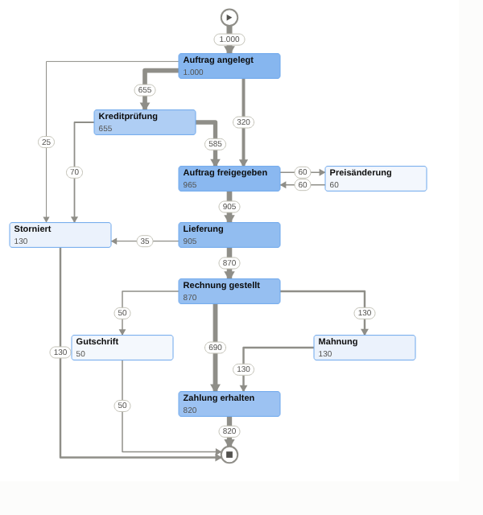

# Process Mining in Databricks AI/BI Dashboards (Mockup)

Process-Mining-Dashboard für Order-to-Cash-Daten, komplett **ohne Databricks App**:

1. **`dashboard.html`: empfohlene Variante.** Ein **Prozessgraph** (Directly-Follows-Graph)
   als Custom Visualization mit Vega-Lite, dazu Übergangs-Heatmaps (Häufigkeit und
   Median-Wartezeit), Varianten-Pareto und der Trend der Durchlaufzeit.
2. **`mockup.html`: reines Sankey** über alle Varianten, als Alternative.


## Prozessgraph als Custom Visualization



* Jede Aktivität erscheint genau einmal, mit Anzahl. Kanten zeigen „B folgt direkt auf A“,
  die Liniendicke entspricht der Häufigkeit. Start ▶ und Ende ■ sind Kreise.
* Tooltips auf Kästen und Kantenbeschriftungen zeigen Anzahl und Median-Wartezeit.
* Vega-Lite kann Graphen **nicht automatisch anordnen**. Deshalb berechnet
  `06_process_graph_dataset.sql` das Layout: Knotenpositionen, Kantenverlauf (rechtwinklig,
  Eingänge verteilt), Pfeilspitzen und Position der Beschriftungen.
  **Anpassen musst du nur die CTE `layout`**, also die Position (x, y) je Aktivität in einem
  Raster von 800 × 840. Unbekannte Aktivitäten landen automatisch in einer Spalte rechts.
* Kantentypen: senkrecht nach unten, seitlich und dann nach unten, in derselben Zeile hin und
  zurück (z. B. Preisänderung), Rücksprünge nach oben (über eine Spur rechts) und Selbstschleifen.
* Die Spezifikation `process_graph.vl.json` wurde lokal mit **Vega-Lite 5.23 und 6.5**
  gerendert, ohne Warnungen. Das Mockup nutzt genau diese Datei.

### Einrichten in Databricks

1. Neues Dataset `process_graph` mit dem SQL aus `06_process_graph_dataset.sql` anlegen.
   Den Parameter `:region` erkennt Databricks automatisch. Standardwert `Alle` setzen und bei
   Bedarf einen Filter-Widget an den Parameter binden.
2. Visualisierung hinzufügen, unter *Advanced* **Custom Viz** wählen, Dataset `process_graph`.
3. Diese Felder hinzufügen, **ohne Aggregation** und mit genau diesen Namen:
   `row_type, id, src, tgt, cases, median_wait_h, x, y, w, h, seq, shape, node_kind`
4. Den Inhalt von `process_graph.vl.json` in den Spezifikations-Editor einfügen. Der Verweis
   `"data": {"name": "databricks_query"}` ist schon drin.
5. Das Widget eher hoch als breit ziehen (Verhältnis ca. 1 : 1,05), dann bleiben Kästen und
   Schrift proportional.

> Custom Visualizations sind laut Databricks-Doku **Public Preview**. Ich konnte sie nicht in
> einem echten Workspace testen, nur die Spezifikation mit der Original-Bibliothek. Prüfe vor
> allem, ob deine Workspace-Version Vega-Lite 5 oder 6 nutzt. Die Spezifikation funktioniert
> mit beiden.

## Alternative: Sankey über alle Varianten (`mockup.html`)


## Dateien

| Datei | Inhalt |
|---|---|
| `01_sample_event_log.sql` | Erzeugt `main.process_mining.event_log` mit synthetischen Daten: 1.000 Fälle, 8 Varianten, 4 Regionen (`case_id`, `activity`, `event_ts`, …) |
| `02_sankey_dataset.sql` | Dashboard-Dataset: ein Prozesspfad pro Zeile, Spalten `step_1` … `step_7` sind die Sankey-Stufen, `cases` ist der Wert |
| `03_kpis_dataset.sql` | Dataset für die KPI-Kacheln und den Trend: Fälle, Varianten, Ø Durchlaufzeit, Storno- und Nacharbeitsquote, Startzeitpunkt |
| `04_transitions_dataset.sql` | Dataset für die Heatmaps: ein Übergang A → B pro Zeile mit Wartezeit (`LEAD()` je Fall) |
| `05_sankey_top_variants_dataset.sql` | Optional: Sankey-Dataset nur mit den Top-5-Varianten, der Rest wird zu „Sonstige Varianten“ |
| `06_process_graph_dataset.sql` | Dataset für den Prozessgraphen: Knoten, Kanten-Stützpunkte, Pfeile und Beschriftungen inkl. Layout |
| `process_graph.vl.json` | Vega-Lite-Spezifikation des Prozessgraphen zum Einfügen in *Custom Viz* |
| `process_mining_sankey.lvdash.json` | Importierbarer Dashboard-Entwurf: Region-Filter, 6 KPIs, 2 Heatmaps, Pareto, Trend, Variantentabelle und ein Platzhalter für den Prozessgraphen |
| `dashboard.html` | Interaktive Vorschau der empfohlenen Dashboard-Seite. Der Prozessgraph wird mit der echten Vega-Lite-Bibliothek gerendert (darum ist die Datei ca. 800 KB groß) |
| `mockup.html` | Interaktive Vorschau des reinen Sankey-Dashboards |

## So funktioniert die Sankey-Logik

Das Sankey-Diagramm in Databricks AI/BI arbeitet mit **Stufen-Spalten** (Stages) und einem
**Wert**. Deshalb wird jeder Fall zuerst in seine geordnete Aktivitätenfolge (Trace)
umgewandelt und dann nach Pfad gruppiert:

```sql
transform(array_sort(collect_list(struct(event_ts, step_no, activity))), x -> x.activity) AS trace
...
try_element_at(trace, 1) AS step_1, ..., try_element_at(trace, 7) AS step_7, COUNT(*) AS cases
```

* Gleiche Aktivitäten in verschiedenen Stufen sind eigene Knoten. Dadurch werden Schleifen
  sichtbar, z. B. "Auftrag freigegeben → Preisänderung → Auftrag freigegeben".
* Kürzere Pfade enden mit `NULL`, der Fluss hört dort auf.
* Bei echten Daten mit langen Traces die Anzahl der Stufen begrenzen (5–7 sind gut lesbar)
  oder seltene Varianten vorher zu "Sonstige" zusammenfassen.

## In Databricks einrichten

1. `01_sample_event_log.sql` im SQL-Editor ausführen. Vorher Katalog und Schema anpassen,
   Standard ist `main.process_mining`.
2. **Variante A, Import:** *Dashboards → Create → Import dashboard from file* und
   `process_mining_sankey.lvdash.json` wählen.
3. **Variante B, manuell**, falls der Import bei einem Widget meckert:
   * Neues Dashboard anlegen. Unter *Data* je ein Dataset aus `02_…` bis `04_…` und `06_…` erstellen.
   * **Heatmap** auf `transitions`: X = `to_activity`, Y = `from_activity`, Farbe = `COUNT(*)`.
     Eine zweite Heatmap mit Farbe = `MEDIAN(wait_h)`.
   * **Prozessgraph:** siehe Abschnitt „Prozessgraph als Custom Visualization“.
   * **Balken** auf `sankey_paths`: Y = `variant`, X = `SUM(cases)`, absteigend sortiert.
   * **Linie** auf `case_kpis`: X = `case_start` (wöchentlich), Y = `AVG(throughput_days)`.
   * Zähler-Kacheln (Counter) auf `case_kpis` anlegen, z. B. `COUNT(case_id)` oder
     `AVG(is_cancelled) * 100`.
   * Einen Multi-Select-Filter auf `region` anlegen und mit allen Datasets verbinden.

> **Hinweis:** Das `.lvdash.json`-Format ist von Databricks nicht öffentlich dokumentiert.
> Die Widget-Definitionen (vor allem die Heatmaps) sind nach bestem Wissen nachgebildet
> und nicht in Databricks getestet. Falls ein Widget nach dem Import leer ist oder fehlt, im
> Editor neu konfigurieren (Variante B). Die SQL-Datasets sind davon nicht betroffen.

## Getestet

Alle SQL-Dateien wurden lokal mit Apache Spark 4.0.1 ausgeführt, das Prozessgraph-Dataset mit `region = 'Alle'` und `'DACH'`. Ergebnis: 5.585 Events,
1.000 Fälle, 8 Varianten, Ø 14,5 Tage Durchlaufzeit, 13 % Storno, 24 % Nacharbeit. Die
Mockups zeigen genau diese Ergebnisse. Die Beispieldaten enthalten typische Wartezeiten je
Aktivität (z. B. Zahlungsziel ca. 11 Tage) und einen simulierten Lieferengpass ab Mai. Lokal ohne Delta musste nur `CREATE OR REPLACE TABLE` durch
`CREATE TABLE` ersetzt werden.
