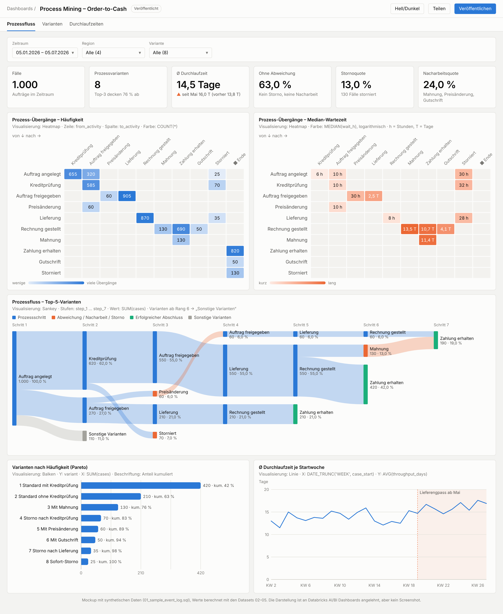
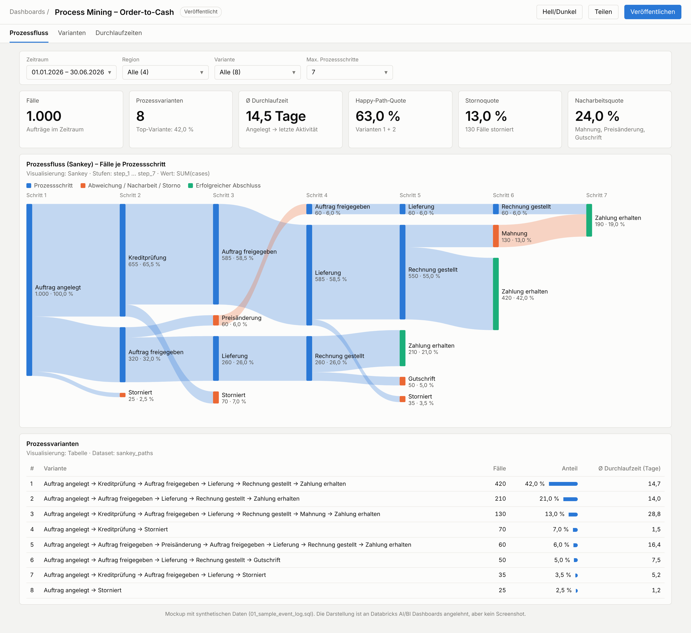

# Process Mining in Databricks AI/BI Dashboards (Mockup)

Zwei Mockups auf denselben synthetischen Order-to-Cash-Daten, beide **ohne Databricks App**
umsetzbar, nur mit nativen AI/BI-Visualisierungen:

1. **`dashboard.html`: empfohlene Variante.** Übergangs-Heatmaps (Häufigkeit und
   Median-Wartezeit) als Ersatz für eine Process Map, Sankey nur für die Top-5-Varianten,
   Varianten-Pareto und Trend der Durchlaufzeit.
2. **`mockup.html`: reines Sankey** über alle Varianten.



### Warum Heatmaps statt nur Sankey?

* Das Sankey rollt Schleifen in Spalten aus und wird bei vielen oder langen Varianten
  unlesbar. Die Heatmap „von × nach“ enthält dieselben Informationen wie eine Process Map
  (Directly-Follows-Graph): jede Aktivität einmal, Schleifen und Rücksprünge direkt sichtbar.
* Die Wartezeit-Heatmap zeigt **Engpässe**. Das Sankey hat keine Zeitdimension.
* Das Sankey bleibt für die Top-5-Varianten im Dashboard, weil es für Präsentationen gut
  funktioniert. Seltene Varianten werden zu „Sonstige“ zusammengefasst.

### Sankey über alle Varianten (`mockup.html`)



## Dateien

| Datei | Inhalt |
|---|---|
| `01_sample_event_log.sql` | Erzeugt `main.process_mining.event_log` mit synthetischen Daten: 1.000 Fälle, 8 Varianten, 4 Regionen (`case_id`, `activity`, `event_ts`, …) |
| `02_sankey_dataset.sql` | Dashboard-Dataset: ein Prozesspfad pro Zeile, Spalten `step_1` … `step_7` sind die Sankey-Stufen, `cases` ist der Wert |
| `03_kpis_dataset.sql` | Dataset für die KPI-Kacheln und den Trend: Fälle, Varianten, Ø Durchlaufzeit, Storno- und Nacharbeitsquote, Startzeitpunkt |
| `04_transitions_dataset.sql` | Dataset für die Heatmaps: ein Übergang A → B pro Zeile mit Wartezeit (`LEAD()` je Fall) |
| `05_sankey_top_variants_dataset.sql` | Sankey-Dataset nur mit den Top-5-Varianten, der Rest wird zu „Sonstige Varianten“ |
| `process_mining_sankey.lvdash.json` | Importierbarer Dashboard-Entwurf: Region-Filter, 6 KPIs, 2 Heatmaps, Sankey Top-5, Pareto, Trend, Variantentabelle |
| `dashboard.html` | Interaktive Vorschau der empfohlenen Dashboard-Seite: Hover-Tooltips, Hell/Dunkel |
| `mockup.html` | Interaktive Vorschau des reinen Sankey-Dashboards |

## So funktioniert die Sankey-Logik

Das Sankey-Diagramm in Databricks AI/BI arbeitet mit **Stufen-Spalten** (Stages) und einem
**Wert**. Deshalb wird jeder Fall zuerst in seine geordnete Aktivitätenfolge (Trace)
umgewandelt und dann nach Pfad gruppiert:

```sql
transform(array_sort(collect_list(struct(event_ts, step_no, activity))), x -> x.activity) AS trace
...
try_element_at(trace, 1) AS step_1, ..., try_element_at(trace, 7) AS step_7, COUNT(*) AS cases
```

* Gleiche Aktivitäten in verschiedenen Stufen sind eigene Knoten. Dadurch werden Schleifen
  sichtbar, z. B. "Auftrag freigegeben → Preisänderung → Auftrag freigegeben".
* Kürzere Pfade enden mit `NULL`, der Fluss hört dort auf.
* Bei echten Daten mit langen Traces die Anzahl der Stufen begrenzen (5–7 sind gut lesbar)
  oder seltene Varianten vorher zu "Sonstige" zusammenfassen.

## In Databricks einrichten

1. `01_sample_event_log.sql` im SQL-Editor ausführen. Vorher Katalog und Schema anpassen,
   Standard ist `main.process_mining`.
2. **Variante A, Import:** *Dashboards → Create → Import dashboard from file* und
   `process_mining_sankey.lvdash.json` wählen.
3. **Variante B, manuell**, falls der Import beim Sankey-Widget meckert:
   * Neues Dashboard anlegen. Unter *Data* je ein Dataset aus `02_…` bis `05_…` erstellen.
   * **Heatmap** auf `transitions`: X = `to_activity`, Y = `from_activity`, Farbe = `COUNT(*)`.
     Eine zweite Heatmap mit Farbe = `MEDIAN(wait_h)`.
   * **Sankey** auf `sankey_top5`: Stufen `step_1` … `step_7`, Wert `SUM(cases)`.
   * **Balken** auf `sankey_paths`: Y = `variant`, X = `SUM(cases)`, absteigend sortiert.
   * **Linie** auf `case_kpis`: X = `case_start` (wöchentlich), Y = `AVG(throughput_days)`.
   * Zähler-Kacheln (Counter) auf `case_kpis` anlegen, z. B. `COUNT(case_id)` oder
     `AVG(is_cancelled) * 100`.
   * Einen Multi-Select-Filter auf `region` anlegen und mit allen Datasets verbinden.

> **Hinweis:** Das `.lvdash.json`-Format ist von Databricks nicht öffentlich dokumentiert.
> Die Widget-Definitionen (vor allem Sankey und Heatmap) sind nach bestem Wissen nachgebildet
> und nicht in Databricks getestet. Falls ein Widget nach dem Import leer ist oder fehlt, im
> Editor neu konfigurieren (Variante B). Die SQL-Datasets sind davon nicht betroffen.

## Getestet

Alle SQL-Dateien wurden lokal mit Apache Spark 4.0.1 ausgeführt. Ergebnis: 5.585 Events,
1.000 Fälle, 8 Varianten, Ø 14,5 Tage Durchlaufzeit, 13 % Storno, 24 % Nacharbeit. Die
Mockups zeigen genau diese Ergebnisse. Die Beispieldaten enthalten typische Wartezeiten je
Aktivität (z. B. Zahlungsziel ca. 11 Tage) und einen simulierten Lieferengpass ab Mai. Lokal ohne Delta musste nur `CREATE OR REPLACE TABLE` durch
`CREATE TABLE` ersetzt werden.
