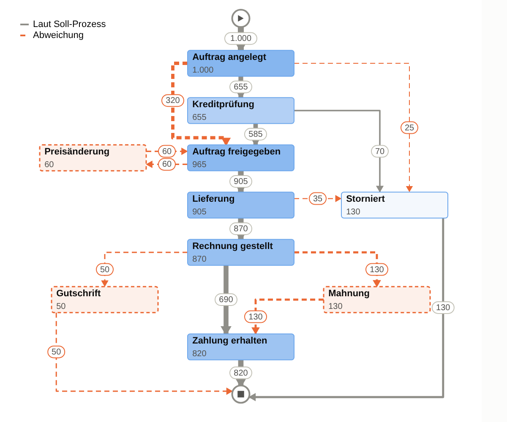

# Prozesskonformität in Databricks AI/BI Dashboards (Mockup)

Ein Dashboard für **Conformance Checking**. Es prüft, ob der reale Ablauf dem definierten
Standardprozess folgt und **ob die Applikation dahinter andere Wege zulässt**.
Das Dashboard braucht keine Databricks App, nur native AI/BI-Visualisierungen und eine
Custom Visualization (Vega-Lite).

## Was das Dashboard beantwortet

| Frage | Element |
|---|---|
| Wie viele Fälle laufen nach Soll-Prozess? | KPI **Konformitätsrate** (ein Fall ist konform, wenn *jeder* Übergang erlaubt ist) |
| Wo genau wird abgewichen? | **Soll-Ist-Prozessgraph**: erlaubte Wege grau, Abweichungen orange gestrichelt, Aktivitäten außerhalb des Soll-Prozesses mit orange gestricheltem Rahmen |
| Seit wann? Wird es besser oder schlechter? | **Konformitätsrate je Startwoche** |
| Welche Art von Abweichung? | **Fälle je Abweichungstyp**: Schritt übersprungen, zusätzliche Aktivität, Rücksprung, Abbruch an unzulässiger Stelle, kein gültiger Abschluss |
| **Lässt die Applikation den Weg noch zu?** | Tabelle **Unzulässige Übergänge**: erstes/letztes Auftreten, Anteil in den letzten 4 Wochen und Status „tritt weiterhin auf“ bzw. „nicht mehr“ |
| Welche Fälle sind betroffen? | Tabelle mit abweichenden Fällen als Drill-down |

In den Beispieldaten sieht man so zwei simulierte Effekte:
- Ab **KW 10** lässt die Applikation eine Freigabe **ohne Kreditprüfung** zu: 320 Fälle,
  41,7 % der Fälle der letzten 4 Wochen. Die Konformitätsrate fällt von ca. 70 % auf ca. 45 %.
- „Storno direkt nach Anlage“ tritt seit April nicht mehr auf, als wäre es behoben worden.

## Soll-Prozess pflegen

Der Standardprozess steht in **`02_process_model.sql`**, in zwei kleinen Tabellen:

* `process_model_activities`: Aktivitäten mit Reihenfolge (`step_order`) und ob sie ein
  zulässiges Ende sind (`is_terminal`, z. B. Storno)
* `process_model_transitions`: **erlaubte direkte Übergänge**, inklusive `▶ Start` und `■ Ende`

Alles, was dort nicht steht, ist eine Abweichung. Alle Datasets und der Graph werten diese
Tabellen automatisch aus. Bei einer Prozessänderung passt du nur diese Tabellen an.

Den Abweichungstyp leitet SQL aus der Reihenfolge ab:

| Typ | Regel |
|---|---|
| Zusätzliche Aktivität | Aktivität nicht im Soll-Prozess |
| Schritt übersprungen | Sprung nach vorne über mindestens einen Soll-Schritt |
| Rücksprung / Wiederholung | zurück zu einem früheren oder gleichen Schritt |
| Abbruch an unzulässiger Stelle | Ende-Aktivität (z. B. Storno) ist von hier aus nicht erlaubt |
| Kein gültiger Abschluss | Fall endet nach einer Aktivität, nach der laut Soll-Prozess kein Ende vorgesehen ist |

## Dateien

| Datei | Inhalt |
|---|---|
| `01_sample_event_log.sql` | Beispiel-Eventlog `main.process_mining.event_log` (1.000 Fälle, Order-to-Cash). Für echte Daten durch das eigene Eventlog ersetzen (`case_id`, `activity`, `event_ts`, `step_no`, `region`) |
| `02_process_model.sql` | **Soll-Prozess**: Aktivitäten und erlaubte Übergänge |
| `03_process_graph_dataset.sql` | Dataset für den Soll-Ist-Prozessgraphen, inklusive Layout und Konformität je Kante und Knoten |
| `04_conformance_cases_dataset.sql` | Konformität je Fall: KPIs, Trend, Drill-down |
| `05_deviations_dataset.sql` | jedes Vorkommen eines unzulässigen Übergangs mit Abweichungstyp |
| `06_deviation_summary_dataset.sql` | je unzulässigem Übergang: Fälle, erstes/letztes Auftreten, Status „weiterhin möglich?“ |
| `process_graph.vl.json` | Vega-Lite-Spezifikation des Prozessgraphen zum Einfügen in *Custom Viz* |
| `process_mining.lvdash.json` | Importierbarer Dashboard-Entwurf (alles außer dem Prozessgraphen, dafür ein Platzhalter) |
| `dashboard.html` | Interaktive Vorschau mit Tooltips und Hell/Dunkel. Der Graph wird mit der echten Vega-Lite-Bibliothek gerendert (darum ca. 800 KB) |
| `alternative_sankey/` | Früherer Entwurf: Prozessfluss als Sankey über alle Varianten |

## Soll-Ist-Prozessgraph (Custom Visualization)

* Vega-Lite kann Graphen **nicht automatisch anordnen**. Deshalb berechnet
  `03_process_graph_dataset.sql` das Layout: Knoten, rechtwinklige Kanten, Pfeilspitzen und
  Position der Beschriftungen. **Anpassen musst du nur die CTE `layout`**, also x/y je Aktivität
  in einem Raster von 800 × 700. Empfehlung: den Standardprozess senkrecht in die Mitte legen,
  Zusatz-Aktivitäten seitlich daneben. Unbekannte Aktivitäten landen automatisch in einer
  Spalte rechts.
* Unterstützte Kantenverläufe: senkrecht, seitlich und dann nach unten, **übersprungene
  Schritte** (links an den Kästen vorbei), hin und zurück in derselben Zeile, Rücksprünge
  nach oben (Spur rechts) und Selbstschleifen.
* Die Spezifikation wurde lokal mit **Vega-Lite 5.23 und 6.5** gerendert, ohne Warnungen.

### Einrichten

1. Dataset `process_graph` aus `03_process_graph_dataset.sql` anlegen. Den Parameter
   `:region` erkennt Databricks automatisch. Standardwert `Alle` setzen und optional einen
   Filter an den Parameter binden. Dasselbe gilt für `06_deviation_summary_dataset.sql`.
2. Visualisierung hinzufügen, unter *Advanced* **Custom Viz** wählen, Dataset `process_graph`.
3. Diese Felder hinzufügen, **ohne Aggregation** und mit genau diesen Namen:
   `row_type, id, src, tgt, cases, median_wait_h, x, y, w, h, seq, shape, node_kind, conformance`
4. Den Inhalt von `process_graph.vl.json` in den Editor einfügen
   (`"data": {"name": "databricks_query"}` ist schon gesetzt).
5. Das Widget etwa im Verhältnis 8 : 7 (Breite : Höhe) ziehen.

## In Databricks einrichten

1. `01_…` (oder das eigene Eventlog) und `02_process_model.sql` im SQL-Editor ausführen.
   Katalog und Schema anpassen, Standard ist `main.process_mining`.
2. *Dashboards → Create → Import dashboard from file*: `process_mining.lvdash.json`.
   In der Import-Version hat `06_…` keinen Regionsfilter, sie wertet immer alle Regionen aus.
3. Den Prozessgraphen wie oben beschrieben anlegen.

Falls ein importiertes Widget leer ist, im Editor neu konfigurieren:
* **Zähler** auf `conformance_cases`, z. B. `AVG(is_conformant) * 100`
* **Linie** auf `conformance_cases`: X = `case_start` (wöchentlich), Y = `AVG(is_conformant) * 100`
* **Balken** auf `deviations`: Y = `deviation_type`, X = `COUNT(DISTINCT case_id)`
* **Tabellen** auf `deviation_summary` und `conformance_cases` (Filter `is_conformant = 0`)

> **Hinweise:**
> * Das `.lvdash.json`-Format ist von Databricks nicht öffentlich dokumentiert. Die
>   Widget-Definitionen sind nach bestem Wissen nachgebildet und nicht in Databricks getestet.
> * Custom Visualizations sind laut Doku **Public Preview** und wurden nicht in einem echten
>   Workspace getestet, nur die Spezifikation mit der Original-Bibliothek.
> * Bei Live-Daten sind **laufende Fälle** noch nicht abgeschlossen. Sie würden als
>   „Kein gültiger Abschluss“ zählen. Dann laufende Fälle ausfiltern, z. B. nur Fälle mit
>   Ende-Aktivität oder älter als X Tage.

## Getestet

Alle SQL-Dateien wurden lokal mit Apache Spark 4.0.1 ausgeführt, die parametrisierten mit
`region = 'Alle'` und `'DACH'`. Ergebnis:

| Kennzahl | Wert |
|---|---|
| Fälle | 1.000 |
| Konformitätsrate | 49,0 % |
| Unzulässige Wege | 6, davon 5 weiterhin möglich |
| Ø Durchlaufzeit konform | 12,3 Tage |
| Ø Durchlaufzeit mit Abweichung | 15,6 Tage |

Das Mockup zeigt genau diese Ergebnisse. Lokal ohne Delta musste nur `CREATE OR REPLACE TABLE`
durch `CREATE TABLE` ersetzt werden.
