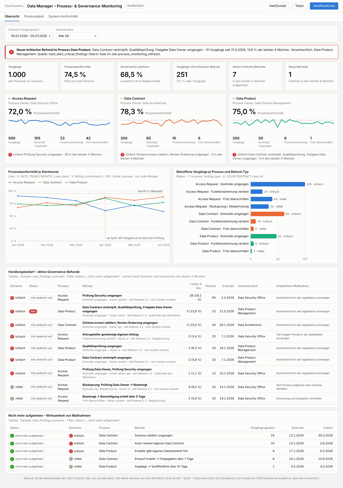
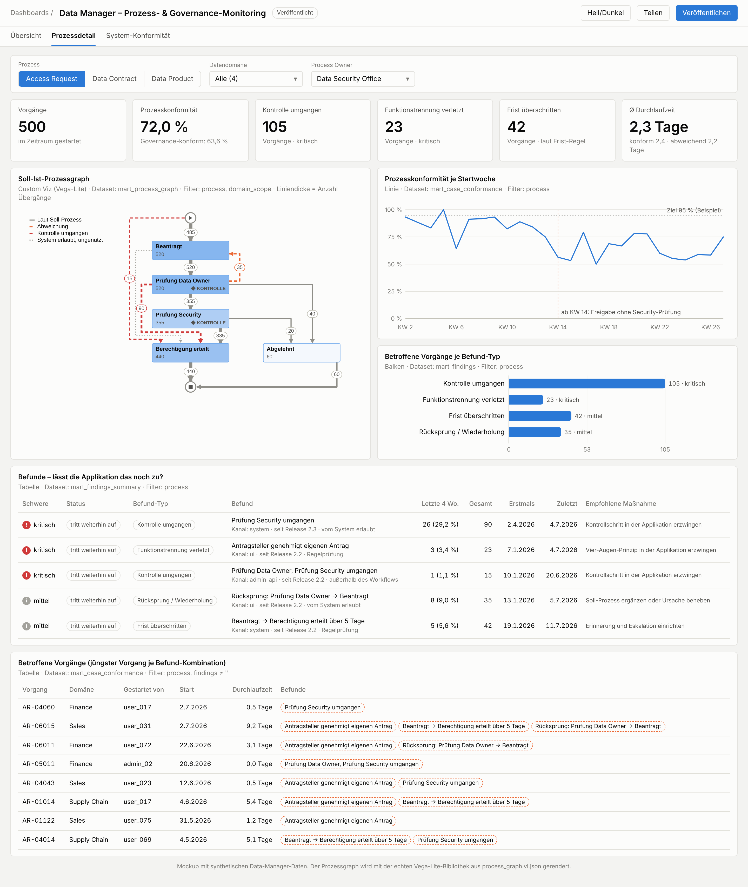

# Data Manager – Prozess- & Governance-Monitoring

Process Mining speziell für den **Data Manager**, die selbst entwickelte Data-Governance- bzw.
Data-Mesh-Applikation (Python, Vue.js, PostgreSQL) für Datenkatalog, Data Contracts, Data
Products, Access Requests, Change Approvals und kanonische Datenmodelle.

Das Monitoring misst, ob die **Ist-Prozesse den definierten Soll-Prozessen entsprechen**, und
meldet **Prozesslücken und Governance-Brüche**:

* **Kontrolle umgangen:** z. B. Berechtigung ohne Security-Prüfung, Datenprodukt ohne Qualitätsprüfung
* **Funktionstrennung verletzt** und **Frist überschritten**
* je Befund **neu**, **tritt weiterhin auf** oder **nicht mehr aufgetreten**: Lässt der Data Manager
  den Weg noch zu?
* **System-Prozess-Konformität:** Soll vs. Status-Maschine vs. Ist, inklusive latenter Lücken und
  Umgehungen am Workflow vorbei. Zusätzlich ein **CI-Check vor jedem Release**.
* **Alarm** an den Process Owner

## Zwei getrennte Teile

| Teil | Ordner | Inhalt |
|---|---|---|
| **1. Data Manager** (Applikation) | [`data_manager/`](data_manager) | erzeugt **alle Daten** fürs Monitoring in PostgreSQL: Footprints (`governance.process_event`, append-only), Status-Maschine je Release, Soll-Modell, Regeln. Dazu Python-Paket, Vue-Bausteine und CI-Check |
| **2. Databricks Asset Bundle** | [`process_monitoring/`](process_monitoring) | eigenständiges Databricks-Projekt: **dbt-Projekt = Data Product**, Dashboard (3 Seiten), Job, Alarm. Liest **nur** per Unity Catalog (Foreign Catalog) |

Dazu kommen [`mockup/`](mockup) (interaktives Zielbild `dashboard.html`, offline lauffähig) und
[`tools/`](tools) (lokale Prüfungen).

## Übersicht

## Prozessdetail mit Soll-Ist-Prozessgraph

Im Graphen bedeuten die Linien:
- grau: erlaubter Weg,
- rot gestrichelt: **umgangene Kontrolle**,
- orange gestrichelt: sonstige Abweichung,
- grau gepunktet: vom System erlaubt, aber ungenutzt.

◆ markiert Kontrollschritte.

## System-Konformität (Soll · System · Ist)

## Für die Übergabe

| Dokument | Zweck |
|---|---|
| [`AGENTS.md`](AGENTS.md) | **Einstieg für den implementierenden System-Agenten:** Leitplanken, Arbeitspakete AP1–AP10 mit Prüfungen, Definition of Done |
| [`HANDOFF_PROMPT.md`](HANDOFF_PROMPT.md) | fertiger Übergabe-Prompt, Checkliste der Zugänge |
| [`IMPLEMENTATION_SPEC.md`](IMPLEMENTATION_SPEC.md) | vollständige Spezifikation: Architektur, Regeln, dbt-Schichten, Dashboard, Abnahmewerte, Risiken |
| [`EVENT_STANDARD.md`](EVENT_STANDARD.md) | Event-Format und Einbindung in den Data Manager |

## Status

`bash tools/verify_all.sh` prüft alles lokal. Letztes Ergebnis: **ALLES BESTANDEN**:
- 17 Python-Tests, davon 6 gegen PostgreSQL 16,
- CI-Check,
- `dbt build` mit Beispieldaten auf Spark + Delta: 50/50 inklusive Abnahmetests,
- Render-Check des Prozessgraphen.

Noch nicht geprüft ist alles in einem echten Databricks-Workspace (Bundle-Deploy, Job,
Dashboard, Custom Viz) sowie die Vue-Bausteine. Das ist Teil des Implementierungsauftrags.
