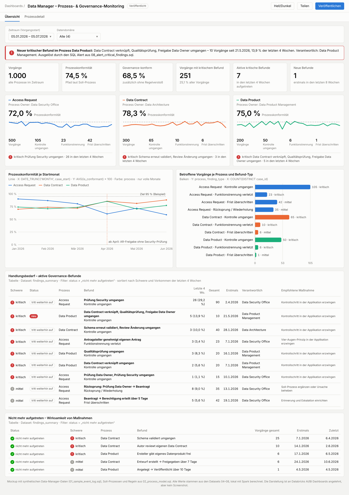
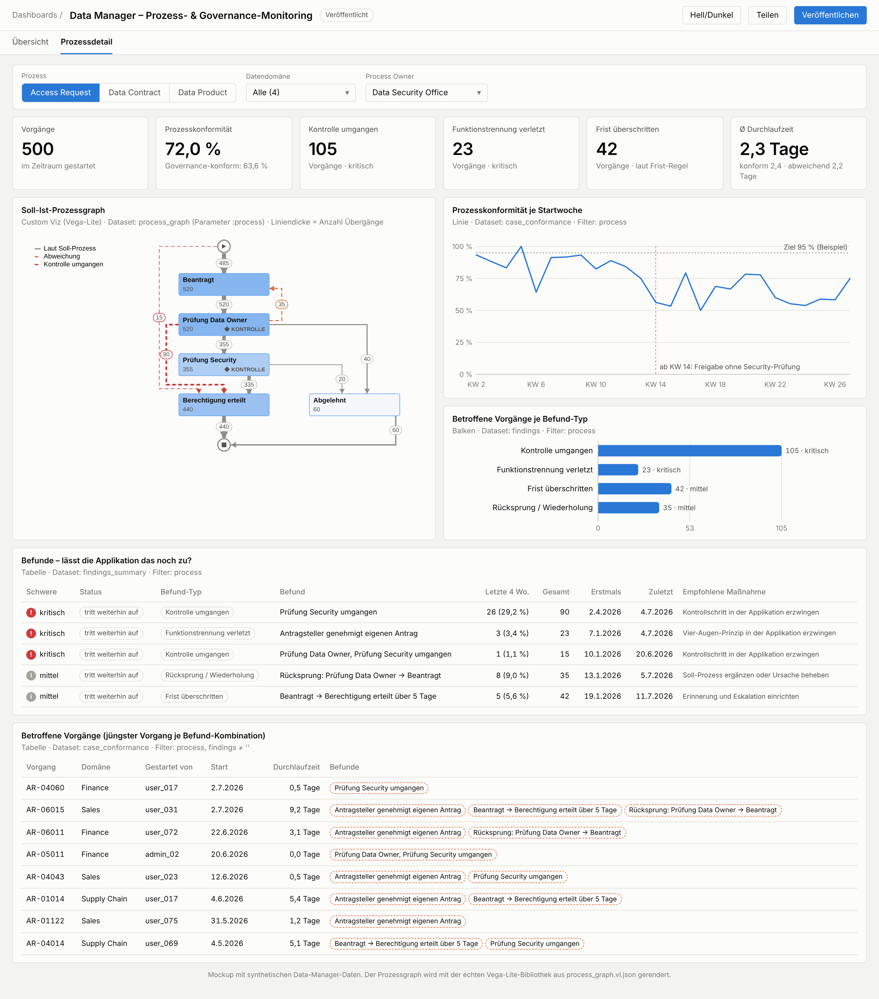
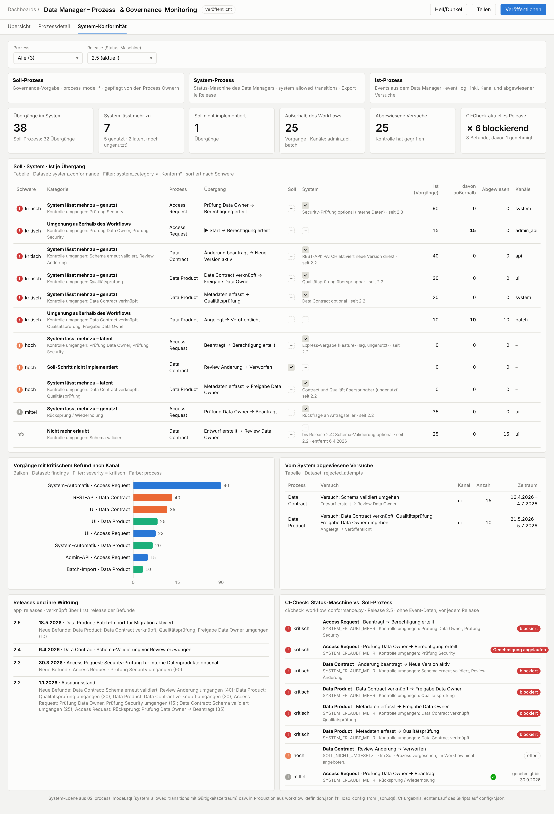

# Data Manager – Prozess- & Governance-Monitoring (Databricks AI/BI)

Process Mining speziell für den **Data Manager**, unsere Data-Governance- bzw.
Data-Mesh-Applikation für Datenkatalog, Data Contracts, Data Products, Access Requests, Change
Approvals und kanonische Datenmodelle. Das Monitoring misst, ob die **Ist-Prozesse den definierten
Soll-Prozessen entsprechen**, und macht **Prozesslücken und Governance-Brüche** sichtbar:

* **Kontrolle umgangen:** z. B. Berechtigung ohne Security-Prüfung, Datenprodukt ohne
  Qualitätsprüfung, Contract-Änderung ohne Review
* **Funktionstrennung verletzt:** Antragsteller genehmigt den eigenen Antrag
* **Frist überschritten:** z. B. Zugriff nicht innerhalb von 5 Tagen
* je Befund: **neu**, **tritt weiterhin auf** oder **nicht mehr aufgetreten**. Das beantwortet,
  ob der Data Manager den Weg noch zulässt.
* **Alarm** an den Process Owner bei neuen bzw. aktuellen kritischen Befunden
* **System-Prozess-Konformität:** Soll-Prozess (Governance) vs. Status-Maschine des Data Managers
  vs. Ist. Findet Wege, die das System zulässt (auch noch **ungenutzte**), Soll-Schritte, die das
  System nicht anbietet, und Umgehungen **am Workflow vorbei** (Admin-API, Batch).
* **CI-Check vor jedem Release:** Die Status-Maschine wird gegen den Soll-Prozess geprüft. Eine
  umgangene Kontrolle ohne genehmigte Ausnahme blockiert das Release.
* **Event-Standard** für den Data Manager: saubere Events an der Quelle, inkl. Kanal, Release und
  abgewiesener Versuche

Umgesetzt ohne Databricks App, nur mit Delta-Tabellen, Views, AI/BI Dashboard (inkl. Custom
Viz mit Vega-Lite) und SQL Alert.

**Für die Implementierung:** Einstieg für den implementierenden Agenten ist
[`AGENTS.md`](AGENTS.md) (Leitplanken, Arbeitspakete, Prüfungen). Den fertigen Auftrag zum
Hineinkopieren enthält [`HANDOFF_PROMPT.md`](HANDOFF_PROMPT.md). Alle Regeln, Datenformate,
Abnahmewerte und offenen Fragen stehen in [`IMPLEMENTATION_SPEC.md`](IMPLEMENTATION_SPEC.md).

## Übersicht



## Prozessdetail mit Soll-Ist-Prozessgraph



Im Graphen sind erlaubte Wege grau. Rot gestrichelt sind **umgangene Kontrollen**, orange
gestrichelt sonstige Abweichungen, grau gepunktet Wege, die das System erlaubt, die aber noch
niemand nutzt. ◆ markiert Kontrollschritte.

## System-Konformität (Soll · System · Ist)



## Dateien

| Datei | Inhalt |
|---|---|
| `01_sample_event_log.sql` | Beispiel-Eventlog: 3 Prozesse, 1.000 Vorgänge, mit typischen Governance-Lücken |
| `02_process_model.sql` | **Konfiguration:** Prozesse, Soll-Prozesse, Kontrollschritte, Regeln, Schweregrade, Graph-Layout |
| `03_views.sql` | Auswertungslogik als Views (Übergänge, Regelverstöße, Befunde, Konformität je Vorgang) |
| `04_ds_process_graph.sql` | Dataset für den Prozessgraphen (Layout in SQL) |
| `05_ds_case_conformance.sql` | Dataset: Vorgänge |
| `06_ds_findings.sql` | Dataset: Befund-Vorkommen |
| `07_ds_findings_summary.sql` | Dataset: Befunde mit Status und Verantwortlichem |
| `08_alert_critical_findings.sql` | Abfrage für den SQL Alert |
| `09_ds_system_conformance.sql` | Dataset: Soll · System · Ist je Übergang |
| `10_ds_rejected_attempts.sql` | Dataset: vom System abgewiesene Versuche |
| `11_load_config_from_json.sql` | Produktion: Soll-Modell und Status-Maschine aus JSON laden (Databricks-spezifisch) |
| `EVENT_STANDARD.md` | Event-Format, Export der Status-Maschine, Datenfluss, Entwickler-Checkliste |
| `config/` | Soll-Prozess (`governance_model.json`) und Status-Maschine (`workflow_definition.json`) als JSON |
| `ci/` | CI-Check (`check_workflow_conformance.py`), genehmigte Ausnahmen, Pipeline-Beispiel |
| `python/` | **Python-Paket `datamanager_governance`** für den Data Manager: Status-Maschine, Events, Speicherung in `process_event`, Export, CI-Check (+ Tests); PostgreSQL-DDL in `python/sql/postgres/` |
| `12_federation_ingest.sql` | Produktion: Footprints per Unity Catalog (Lakehouse Federation) aus PostgreSQL nach Delta übernehmen (Databricks-spezifisch) |
| `examples/` | Demo des Pakets und Beispiel-Events |
| `process_graph.vl.json` | Vega-Lite-Spezifikation für Custom Viz |
| `process_mining.lvdash.json` | Dashboard-Entwurf zum Import (ungetestet; ohne Prozessgraph, dafür ein Platzhalter) |
| `dashboard.html` | Interaktives Mockup, im Browser öffnen, funktioniert offline |
| `AGENTS.md` | **Einstieg für den System-Agenten:** Ziel, Leitplanken, Arbeitspakete AP1–AP10 mit Prüfungen, Definition of Done |
| `HANDOFF_PROMPT.md` | Fertiger Übergabe-Prompt und Checkliste für Zugänge |
| `IMPLEMENTATION_SPEC.md` | Vollständige Spezifikation zur Implementierung |
| `tools/` | Prüfwerkzeuge: `verify_all.sh`, `local_sql_check.py` (Abnahmewerte), `check_vega_spec.mjs` (Render-Check) |

## Schnellstart

1. `01_…` (oder eine View auf das echte Data-Manager-Log), `02_…` und `03_…` im SQL-Editor
   ausführen.
2. Dashboard: `process_mining.lvdash.json` importieren oder manuell nach der Spezifikation
   aufbauen. Den Prozessgraphen als Custom Viz mit `04_…` und `process_graph.vl.json` anlegen.
3. SQL Alert mit `08_…` einrichten.
4. Im Data Manager (Python) das Paket einbinden und den CI-Check in die Release-Pipeline aufnehmen:
   ```bash
   pip install ./python[test]
   pytest python/tests
   dm-export-workflow --out build/workflow_definition.json
   dm-check-workflow --model config/governance_model.json --workflow build/workflow_definition.json --accepted ci/accepted_deviations.json
   ```

Neue Prozesse oder Prozessänderungen pflegst du **nur in `02_process_model.sql`**.

## Status

`bash tools/verify_all.sh` prüft alles lokal (Ergebnis zuletzt: **ALLES BESTANDEN**).

Alle Databricks-SQL-Dateien außer `11_…` und `12_…` sind lokal mit Apache Spark 4.0.1 getestet. Das
Python-Paket hat 15 grüne Tests, davon 5 gegen echtes PostgreSQL 16. Der Kern braucht nur die
Standardbibliothek. Die PostgreSQL-DDL (append-only, Rollen) ist gegen PostgreSQL 16 getestet. Die Vega-Lite-Spezifikation
rendert in Vega-Lite 5 und 6 ohne Warnungen. In einem echten Databricks-Workspace ist **noch
nichts** getestet, das ist Teil des Implementierungsauftrags.
